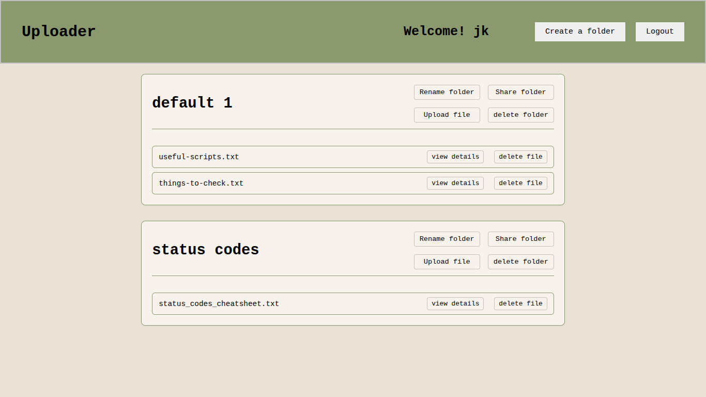
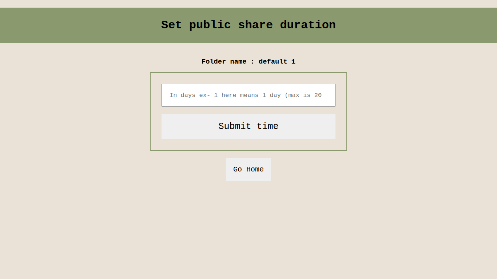
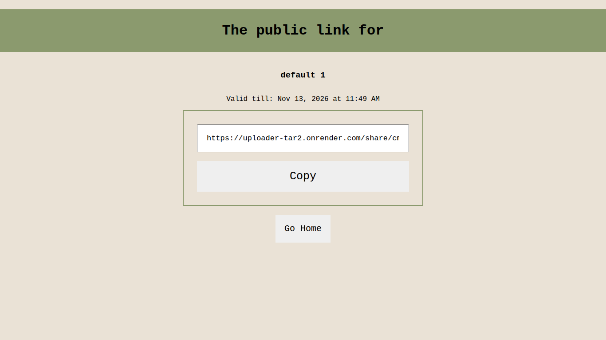

# File-Uploader







A File Uploader app, where you can upload any files and share them with friends!


[Live site link](https://uploader-tar2.onrender.com/)


## Disclaimer

- Backend is running on render (free-tier) which can have a bit of a cold start (could take 40-60 sec). Please be patient :) .
- It is also backend rendered (ejs).


## Usage

1. Register & login 
2. To upload a file, you need to create a folder (files can be placed in a folder)
3. You can share a folder publicly.
4. A timer can be set on that folder which will dictate on how long that folder is available publicly.

## Features

- Public sharing available
- File handling using multer
- Supabase bucket used.


## Installation

### Back-end setup

```
git clone https://github.com/jk301/uploader.git
```

```
cd uploader
```

```
npm install
```

- create an ENV that will need 
1. A database(prisma postgres) link.
2. For local give a PORT
3. Create a supabase account and put in the URL & SECRET 

```
npx prisma generate
```

```
npx prisma migrate dev
```

and finally 

```
node app.js
```
